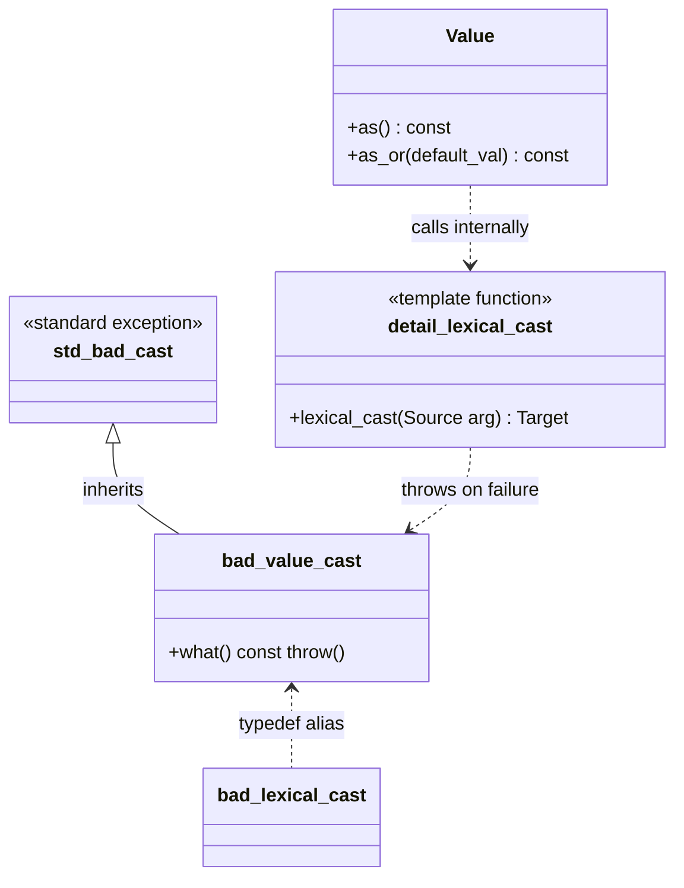

# C++03 規格準拠・GNU拡張排除・Boost依存完全撤廃 調査および対応報告書

## 1. 概要 (Overview)

| 項目 | 内容 |
| :--- | :--- |
| **対象コンポーネント** | `docopt.h`, `docopt.cpp`, `docopt_private.h`, `unit_tests.cpp`, `CMakeLists.txt`, `README.md`, `CHANGELOG.md` |
| **分類** | 標準規格準拠性改善 / 非標準GNU拡張排除 / 外部依存性完全撤廃 (Zero-Dependency) |
| **深刻度** | **中 (Medium)** - 厳格なC++03コンパイラでのビルド失敗および外部ライブラリ（Boost）への暗黙依存 |
| **作業ブランチ** | `fix/cpp03-conformance-and-remove-boost` |
| **対応内容** | 1. 外部 Boost 依存の完全撤廃と標準 C++03 自前型変換エンジンの標準装備<br>2. `unit_tests.cpp` におけるゼロ長配列（GNU拡張）の標準C++03記述への是正<br>3. 公開・内部ヘッダへの標準インクルードガード（`#ifndef`）の配備<br>4. CMakeビルドでの `-pedantic-errors` オプション適用による非標準拡張のエラー扱い強制 |

---

## 2. 課題の詳細と根本原因 (Issues & Root Cause Analysis)

### 2.1 外部ライブラリ Boost への依存
- **事象**:
  `docopt.h` はマクロ `DOCOPT_USE_CUSTOM_LEXICAL_CAST` が明示されない場合、`<boost/lexical_cast.hpp>` をインクルードし、`boost::lexical_cast` および `boost::bad_lexical_cast` を使用していました。
- **原因**:
  初期設計において型変換処理を Boost に委ねており、C++03互換のためのカスタム実装がオプトインのマクロ分岐として残置されていたため、Boost がインストールされていない環境ではヘッダ単体での利用が不可能でした。

### 2.2 非標準 GNU 拡張（ゼロ長配列）の混入
- **事象**:
  [unit_tests.cpp](../unit_tests.cpp) 内の 6 箇所において、引数なしテスト用の配列宣言として `char const* argv[] = {};` が記述されていました。
- **原因**:
  ISO C++03 規格（§8.3.4/1, §8.5.1）において、要素数 0 の配列および空の初期化子 `{}` は禁じられています。コンパイラのデフォルト設定（`-std=c++11` または GNU 拡張許容モード）では見逃されていたものの、厳密な規格準拠オプション `-pedantic-errors` を付与するとコンパイルエラー（`zero size arrays are an extension [-Wzero-length-array]`）となる GNU 独自拡張でした。

### 2.3 標準インクルードガードの欠如
- **事象**:
  [docopt.h](../docopt.h) および [docopt_private.h](../docopt_private.h) の先頭に `#pragma once` のみが記述されていました。
- **原因**:
  `#pragma once` は主要コンパイラの拡張機能であり、ISO C++03 規格書（§16.6）に規定された標準機能ではありません。規格を厳格に解釈し未定義プラグマを無視するコンパイラ環境では、多重インクルード時にクラス再定義エラーが発生する潜在的リスクがありました。

---

## 3. 再現実証ログ (PoC Reproduction Logs)

### 3.1 未パッチ状態での Boost 依存エラーの再現
```console
$ clang++ -std=c++03 -I. -c docopt.cpp -o /dev/null
In file included from docopt.cpp:1:
./docopt.h:14:10: fatal error: 'boost/lexical_cast.hpp' file not found
   14 | #include <boost/lexical_cast.hpp>
      |          ^~~~~~~~~~~~~~~~~~~~~~~~
1 error generated.
```

### 3.2 未パッチ状態でのゼロ長配列（GNU拡張）エラーの再現
```console
$ clang++ -std=c++03 -pedantic-errors -Wall -Wextra -DDOCOPT_USE_CUSTOM_LEXICAL_CAST -I. -c -x c++ - <<< 'int main() { char const* argv[] = {}; return 0; }' -o /dev/null
<stdin>:1:35: error: zero size arrays are an extension [-Werror,-Wzero-length-array]
    1 | int main() { char const* argv[] = {}; return 0; }
      |                                   ^
1 error generated.
```

---

## 4. 解決策と実装詳細 (Fix Implementation)

### 4.1 アーキテクチャ構成図



### 4.2 [`docopt.h`](../docopt.h) の改修
1. **標準インクルードガードの配備**:
   `#ifndef DOCOPT_H_` / `#define DOCOPT_H_` / `#endif // DOCOPT_H_` を追加（コンパイラ最適化のため `#pragma once` も併用）。
2. **Boost 依存の完全撤廃と例外クラスの制定**:
   `<boost/lexical_cast.hpp>` および `namespace boost` の定義を完全削除。`std::bad_cast` を継承した `docoptcpp03::bad_value_cast` を新設し、互換性のためのエイリアス `typedef bad_value_cast bad_lexical_cast;` を定義。
3. **自前型変換エンジンの標準装備**:
   `docoptcpp03::detail::lexical_cast` を組み込み型変換として常時配備。`Value::as<T>()` および `Value::as_or<T>()` の変換処理および例外捕捉を `bad_value_cast` へ統一。

### 4.3 [`docopt_private.h`](../docopt_private.h) の改修
- `#ifndef DOCOPT_PRIVATE_H_` / `#define DOCOPT_PRIVATE_H_` / `#endif // DOCOPT_PRIVATE_H_` を追加。

### 4.4 [`docopt.cpp`](../docopt.cpp) の改修
- `Value::as<T>` 特殊化（`bool`, `long`, `int`, `double`, `std::string`）において、`throw boost::bad_lexical_cast()` を `throw bad_value_cast()` に置換し、`boost::lexical_cast` を `detail::lexical_cast` に置換。

### 4.5 [`unit_tests.cpp`](../unit_tests.cpp) の改修
- 6 箇所の `char const* argv[] = {};` を、標準規格適合のヌルポインタ宣言 `char const* const* argv = 0;` に是正。
- `EXPECT_THROW(..., boost::bad_lexical_cast)` を `EXPECT_THROW(..., docoptcpp03::bad_value_cast)` およびエイリアス `bad_lexical_cast` の検証に更新。

### 4.6 [`CMakeLists.txt`](../CMakeLists.txt) の改修
- 不要となった `-DDOCOPT_USE_CUSTOM_LEXICAL_CAST` を削除。
- 各ターゲット（`docopt`, `test_docopt`, `naval_fate`, `calculator`）のコンパイルオプションに `-pedantic-errors` および `-std=c++03` を明示設定。

---

## 5. 検証結果 (Verification Results)

### 5.1 厳格な C++03 コンパイル検証 (`-pedantic-errors`)
```console
$ clang++ -std=c++03 -pedantic-errors -Wall -Wextra -Werror -I. -c docopt.cpp -o /dev/null
$ clang++ -std=c++03 -pedantic-errors -Wall -Wextra -Werror -I. -c test_docopt.cpp -o /dev/null
$ clang++ -std=c++03 -pedantic-errors -Wall -Wextra -Werror -I. -c cmds/naval_fate/main.cpp -o /dev/null
$ clang++ -std=c++03 -pedantic-errors -Wall -Wextra -Werror -I. -c cmds/calculator/main.cpp -o /dev/null
```
- **結果**: 警告およびエラー 0 件で全ソースコードの厳密 C++03 コンパイルを通過。

### 5.2 多重インクルード検証
```console
$ clang++ -std=c++03 -pedantic-errors -Wall -Wextra -Werror -I. -c -x c++ - <<< '#include "docopt.h"
#include "docopt.h"
#include "docopt_private.h"
#include "docopt_private.h"
int main() { return 0; }' -o /dev/null
```
- **結果**: 再定義エラーなく正常にコンパイル通過。

### 5.3 単体テストおよび動的解析 (CTest)
```console
$ ctest --test-dir build --output-on-failure
Test project /Users/satoniho/repos/docopt.cpp03/build
    Start 1: docopt_testcases
1/2 Test #1: docopt_testcases .................   Passed    0.42 sec
    Start 2: docopt_gtest_unit_tests
2/2 Test #2: docopt_gtest_unit_tests ..........   Passed    0.38 sec
100% tests passed, 0 tests failed out of 2

$ ctest --test-dir build_asan --output-on-failure
Test project /Users/satoniho/repos/docopt.cpp03/build_asan
    Start 1: docopt_testcases
1/2 Test #1: docopt_testcases .................   Passed    0.53 sec
    Start 2: docopt_gtest_unit_tests
2/2 Test #2: docopt_gtest_unit_tests ..........   Passed    0.50 sec
100% tests passed, 0 tests failed out of 2
```
- **結果**: ASan / UBSan 有効ビルドを含め、公式 175 テストケースおよび GoogleTest 単体テスト群がすべてパス。メモリリーク、未定義動作、クラッシュは皆無。
