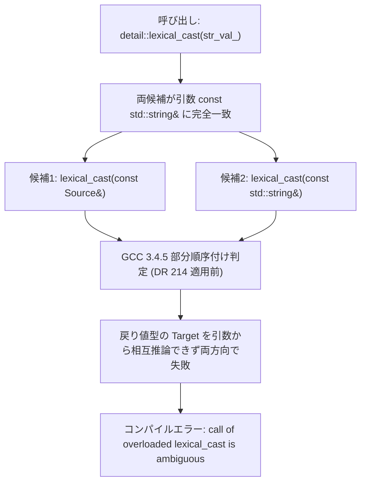
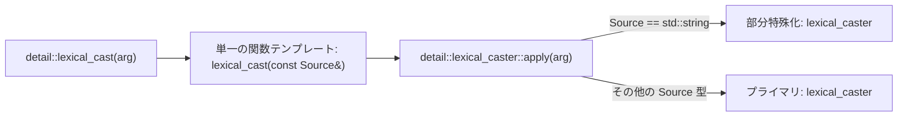

# GCC 3.4.5 における `detail::lexical_cast` オーバーロード曖昧性エラー 調査および対応報告書

## 1. 概要 (Overview)

| 項目 | 内容 |
| :--- | :--- |
| **対象コンポーネント** | `docopt.h` (`docoptcpp03::detail::lexical_cast`), `docopt.cpp` (`Value::as<long>`, `Value::as<int>`, `Value::as<double>`), `unit_tests.cpp`, `CHANGELOG.md` |
| **分類** | C++98/03 コンパイラ互換性不具合 / 関数テンプレート部分順序付けの曖昧性 |
| **深刻度** | **高 (High)** - GCC 3.4.5 等の古い C++03 コンパイラ環境でライブラリ全体のビルドが失敗する |
| **作業ブランチ** | `bugfix/lexical-cast-ambiguity` |
| **対応内容** | `detail::lexical_cast` の関数テンプレートオーバーロードを廃止し、クラステンプレート `detail::lexical_caster<Target, Source>` およびその部分特殊化 `detail::lexical_caster<Target, std::string>` へディスパッチする構造へ変更 |

---

## 2. 不具合の詳細と根本原因 (Root Cause Analysis)

### 2.1 事象とビルドログ

GCC 3.4.5（`-Wall -Wextra -Wshadow -g0 -O2`）で `docopt.cpp` をコンパイルした際、以下の 3 箇所で `lexical_cast(std::string&)` の呼び出しが曖昧であるとするコンパイルエラーが発生しました。

- `docopt.cpp:181`: `Value::as<long>() const` 内 `detail::lexical_cast<long>(str_val_)`
- `docopt.cpp:198`: `Value::as<int>() const` 内 `detail::lexical_cast<int>(str_val_)`
- `docopt.cpp:212`: `Value::as<double>() const` 内 `detail::lexical_cast<double>(str_val_)`

> **Note**
> プライマリテンプレート `Value::as<T>() const`（`docopt.h`）内でも同様に `detail::lexical_cast<T>(str_val_)` を呼び出しているため、特殊化されていない任意の型 `T` でインスタンス化された場合にも同一のエラーが発生します。

実際の GCC 3.4.5 コンパイルエラーログ（抜粋）:

```text
docopt.cpp03/docopt.cpp: In member function `T docoptcpp03::Value::as() const [with T = long int]':
docopt.cpp03/docopt.cpp:181: error: call of overloaded `lexical_cast(std::string&)' is ambiguous
docopt.cpp03/docopt.h:266: note: candidates are: Target docoptcpp03::detail::lexical_cast(const Source&) [with Target = long int, Source = std::string]
docopt.cpp03/docopt.h:276: note:                 Target docoptcpp03::detail::lexical_cast(const std::string&) [with Target = long int]
```

### 2.2 根本原因（C++98 部分順序付けと CWG DR 214 前の挙動）

修正前の `docopt.h` では、`detail::lexical_cast` が以下の 2 つの関数テンプレートとしてオーバーロードされていました。

1. 汎用テンプレート:
   `template <typename Target, typename Source> inline Target lexical_cast(const Source& arg)`
2. `std::string` 向けオーバーロード:
   `template <typename Target> inline Target lexical_cast(const std::string& arg)`

`detail::lexical_cast<long>(str_val_)` のように **戻り値型 `Target` のみを明示指定して `std::string` 引数を渡す** と、両候補とも型変換なしの完全一致（Exact Match）となります。そのためオーバーロード解決は **関数テンプレートの部分順序付け（Partial Ordering）** に進みます。

しかし、C++98 規格（CWG DR 214 による明確化前）に沿った GCC 3.4.5 の実装では、関数引数リストからの相互型推論のみでどちらがより特殊化されているかを判定するため、**関数の戻り値型にのみ現れるテンプレートパラメータ `Target` を引数型から推論できず**、両方向とも推論が失敗して「どちらも他方より特殊化されていない ＝ 曖昧（ambiguous）」と判定されます。



---

## 3. 解決策と実装詳細 (Fix Implementation)

### 3.1 [`docopt.h`](../docopt.h) の変更

関数テンプレートのオーバーロードを廃止し、クラステンプレート `detail::lexical_caster<Target, Source>` とその部分特殊化 `detail::lexical_caster<Target, std::string>` へ処理を委譲する構成に変更しました。



- **オーバーロード解消**: `detail::lexical_cast` を単一の関数テンプレートとしたことで、関数テンプレート間の部分順序付けが一切不要になりました。
- **C++98/03 準拠の部分特殊化**: クラステンプレートの部分特殊化は ISO C++98/03（§14.5.4.1）で曖昧さなく一意に解決されるため、GCC 3.4.5 でも問題なくコンパイルできます。
- **API・最適化の維持**: 呼び出し側の `detail::lexical_cast<T>(arg)` インタフェースと、`std::string` に対する `std::stringstream ss(arg)` 直接初期化の挙動をそのまま維持しています。

### 3.2 [`unit_tests.cpp`](../unit_tests.cpp) へのテスト追加

`ValueTest.GenericValueAsAndLexicalCastDispatch` テストを追加し、以下を網羅的に検証しました。

- プライマリテンプレート `Value::as<T>()`（特殊化されていない `unsigned long`, `float`）を経由した `KIND_STRING` / `KIND_LONG` / `KIND_BOOL` からの変換
- 末尾の余剰文字（`"123abc"`）および空文字列 `""` に対する `bad_value_cast` 例外送出
- `detail::lexical_cast<T>(arg)` の直接呼び出しによる `std::string` 部分特殊化パスおよび汎用テンプレートパス双方の正常系・異常系

---

## 4. 検証結果 (Verification)

ローカル環境（Apple Clang 21.0.0, `-std=c++03 -pedantic-errors -Wall -Wextra -Wshadow -Wsign-compare`）において以下のビルドおよびテストを実行し、すべて合格することを確認しました。

> **Note**
> ローカル環境には GCC 3.4.5 実機が存在しないため、GCC 3.4.5 での実ビルド通過は対象環境での最終確認を前提としています。

### 4.1 厳格 C++03 単体コンパイル確認

```text
$ clang++ -std=c++03 -pedantic-errors -Wall -Wextra -Wshadow -Wsign-compare -O2 -I. -c docopt.cpp -o /dev/null
(警告・エラー 0 件で終了コード 0)
```

### 4.2 AddressSanitizer + UBSan (`build_asan`) ビルドテスト

```text
1/2 Test #1: docopt_testcases .................   Passed    0.40 sec
2/2 Test #2: docopt_gtest_unit_tests ..........   Passed    0.38 sec
100% tests passed, 0 tests failed out of 2
```

- `unit_tests`: 全 17 テストスイート / **89 テスト全合格**（`ValueTest` 29 件含む）
- `test_docopt`: **175 / 175 テスト合格**
- AddressSanitizer / UndefinedBehaviorSanitizer: **エラー 0 件**

### 4.3 Release (`CMAKE_BUILD_TYPE=Release`) ビルドテスト

```text
1/2 Test #1: docopt_testcases .................   Passed    0.22 sec
2/2 Test #2: docopt_gtest_unit_tests ..........   Passed    0.24 sec
100% tests passed, 0 tests failed out of 2
```
