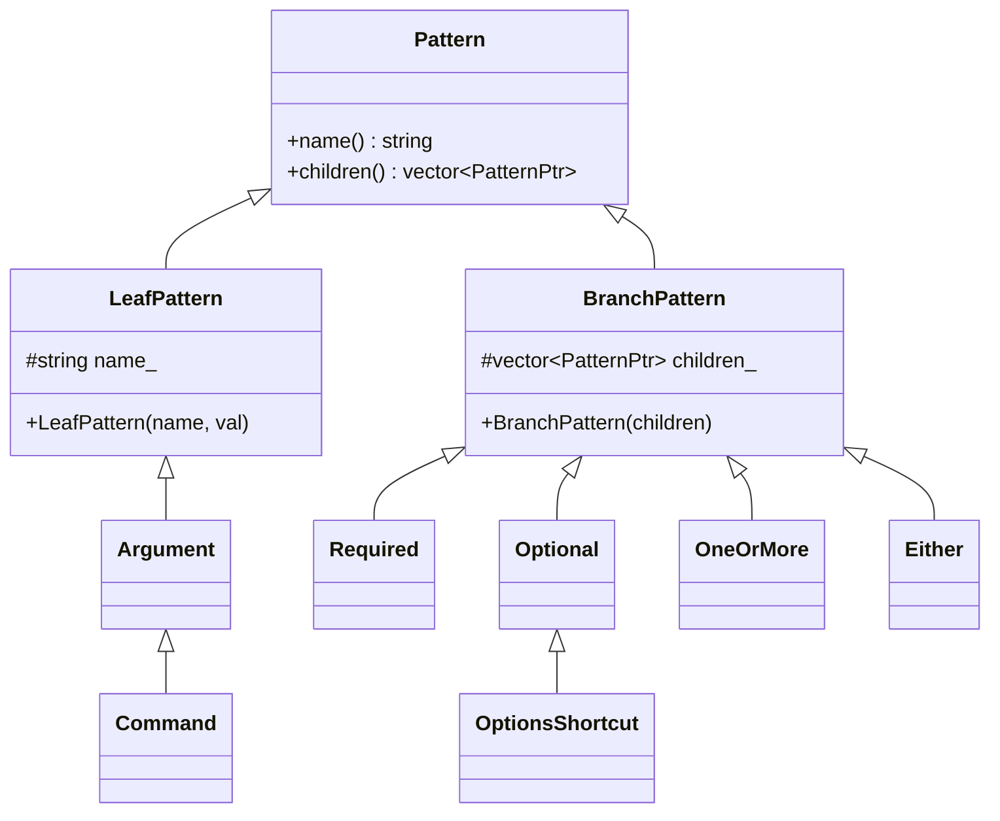

# GCC 3.4.5 における `-Wshadow` 警告 調査および対応報告書

## 1. 概要 (Overview)

| 項目 | 内容 |
| :--- | :--- |
| **対象コンポーネント** | `docopt.cpp` (`LeafPattern`, `Argument`, `Command`, `BranchPattern`, `Required`, `Optional`, `OptionsShortcut`, `OneOrMore`, `Either`), `CHANGELOG.md` |
| **分類** | 古い GCC コンパイラ互換性改善 / `-Wshadow` 警告解消 |
| **深刻度** | **低 (Low)** - 実行時動作への影響はないが、GCC 3.4.5 環境の `-Wshadow`（および `-Werror` 併用時）で警告／ビルドエラーとなる |
| **作業ブランチ** | `fix/wshadow-warnings` |
| **対応内容** | 基底クラス `Pattern` のメンバ関数 `name()` / `children()` と同名のコンストラクタ仮引数を、`pattern_name` / `child_patterns` へリネーム（`static` メンバ関数内のローカル変数は対象外） |

---

## 2. 事象と根本原因 (Root Cause Analysis)

### 2.1 GCC 3.4.5 での警告ログ

GCC 3.4.5（`-Wall -Wextra -Wshadow`）で `docopt.cpp` をコンパイルした際、以下の 9 箇所のコンストラクタにおいて `shadows a member of 'this'` 警告が発生しました。

```text
docopt.cpp03/docopt.cpp: In constructor `docoptcpp03::LeafPattern::LeafPattern(const std::string&, const docoptcpp03::Value&)':
docopt.cpp03/docopt.cpp:403: warning: declaration of 'name' shadows a member of 'this'
docopt.cpp03/docopt.cpp: In constructor `docoptcpp03::Argument::Argument(const std::string&, const docoptcpp03::Value&)':
docopt.cpp03/docopt.cpp:499: warning: declaration of 'name' shadows a member of 'this'
docopt.cpp03/docopt.cpp: In constructor `docoptcpp03::Command::Command(const std::string&, const docoptcpp03::Value&)':
docopt.cpp03/docopt.cpp:543: warning: declaration of 'name' shadows a member of 'this'
docopt.cpp03/docopt.cpp: In constructor `docoptcpp03::BranchPattern::BranchPattern(const std::vector<docoptcpp03::PatternPtr, std::allocator<docoptcpp03::PatternPtr> >&)':
docopt.cpp03/docopt.cpp:648: warning: declaration of 'children' shadows a member of 'this'
docopt.cpp03/docopt.cpp: In constructor `docoptcpp03::Required::Required(const std::vector<docoptcpp03::PatternPtr, std::allocator<docoptcpp03::PatternPtr> >&)':
docopt.cpp03/docopt.cpp:670: warning: declaration of 'children' shadows a member of 'this'
docopt.cpp03/docopt.cpp: In constructor `docoptcpp03::Optional::Optional(const std::vector<docoptcpp03::PatternPtr, std::allocator<docoptcpp03::PatternPtr> >&)':
docopt.cpp03/docopt.cpp:706: warning: declaration of 'children' shadows a member of 'this'
docopt.cpp03/docopt.cpp: In constructor `docoptcpp03::OptionsShortcut::OptionsShortcut(const std::vector<docoptcpp03::PatternPtr, std::allocator<docoptcpp03::PatternPtr> >&)':
docopt.cpp03/docopt.cpp:739: warning: declaration of 'children' shadows a member of 'this'
docopt.cpp03/docopt.cpp: In constructor `docoptcpp03::OneOrMore::OneOrMore(const std::vector<docoptcpp03::PatternPtr, std::allocator<docoptcpp03::PatternPtr> >&)':
docopt.cpp03/docopt.cpp:752: warning: declaration of 'children' shadows a member of 'this'
docopt.cpp03/docopt.cpp: In constructor `docoptcpp03::Either::Either(const std::vector<docoptcpp03::PatternPtr, std::allocator<docoptcpp03::PatternPtr> >&)':
docopt.cpp03/docopt.cpp:801: warning: declaration of 'children' shadows a member of 'this'
```

### 2.2 根本原因（GCC 3.4.5 と現代コンパイラの `-Wshadow` 仕様差）

AST ノードの基底クラス `Pattern` および派生クラスでは、メンバ変数には末尾アンダースコア（`name_`, `children_`）を付けて区別していたものの、アクセサの**メンバ関数名**が `name()` および `children()` でした。



- **GCC 3.4.5 で警告が出る理由**: GCC 3.4.5（および GCC 4.x 中期まで）の `-Wshadow` は、非静的メンバ関数やコンストラクタ（`this` を持つスコープ）において、**メンバ変数だけでなく（基底クラスを含む）メンバ関数と同名の仮引数・ローカル変数**に対しても `shadows a member of 'this'` 警告を発行していました。
- **Clang や新しい GCC (4.8 以降) で警告が出ない理由**: 変数とメンバ関数は構文上の役割が異なり、仮引数にアクセサと同じ名前を用いるのは一般的なイディオムであるため、誤検知（ノイズ）を減らす目的でメンバ関数との同名衝突は原則 `-Wshadow` の対象外へと改められました。
- **補足**: `Argument::parse` 内のローカル変数 `name` については `static` メンバ関数（`this` ポインタが存在しないスコープ）であるため GCC 3.4.5 でも警告の対象にならず、今回の修正対象からも除外しています。

### 2.3 コード全域の網羅調査結果

801 行目以降の `docopt.cpp`（`Either::match`, `Pattern::fix*`, `Tokens`, `Options` 等の全非静的メンバ関数）、ならびに [docopt.h](../docopt.h) および [docopt_private.h](../docopt_private.h) についても精査した結果、他にクラスメンバ（変数・関数）をシャドウする仮引数およびローカル変数は存在しませんでした。

---

## 3. 解決策と実装詳細 (Fix Implementation)

[docopt.cpp](../docopt.cpp) 内の該当 9 箇所のコンストラクタ仮引数名を、既存の `DocoptExit` コンストラクタ（`usage` に対する `usage_str`、`status` に対する `exit_status`）の慣習にならい、メンバ関数名と衝突しない識別子へ変更しました。

| クラス | 変更前の仮引数 | 変更後の仮引数 |
| :--- | :--- | :--- |
| `LeafPattern`, `Argument`, `Command` | `name` | `pattern_name` |
| `BranchPattern`, `Required`, `Optional`, `OptionsShortcut`, `OneOrMore`, `Either` | `children` | `child_patterns` |

これらはすべて `docopt.cpp` 内の内部 AST クラスであるため、公開 API（`docopt.h`）やバイナリ互換性への影響はありません。

---

## 4. 検証結果 (Verification)

ローカル環境（Apple Clang 21.0.0, `-std=c++03 -pedantic-errors -Wall -Wextra -Wshadow -Wsign-compare`）において以下のビルドおよびテストを実行し、すべて合格することを確認しました。

> **Note**
> ローカル環境には GCC 3.4.5 実機が存在しないため、GCC 3.4.5 実機での警告解消は対象環境での最終確認を前提としています。

### 4.1 厳格 C++03 単体コンパイル確認

```text
$ clang++ -std=c++03 -pedantic-errors -Wall -Wextra -Wshadow -Wsign-compare -O2 -I. -c docopt.cpp -o /dev/null
(警告・エラー 0 件で終了コード 0)
```

### 4.2 AddressSanitizer + UBSan (`build_asan`) ビルドテスト

```text
1/2 Test #1: docopt_testcases .................   Passed    0.41 sec
2/2 Test #2: docopt_gtest_unit_tests ..........   Passed    0.36 sec
100% tests passed, 0 tests failed out of 2
```

### 4.3 Release (`CMAKE_BUILD_TYPE=Release`) ビルドテスト

```text
1/2 Test #1: docopt_testcases .................   Passed    0.20 sec
2/2 Test #2: docopt_gtest_unit_tests ..........   Passed    0.24 sec
100% tests passed, 0 tests failed out of 2
```
