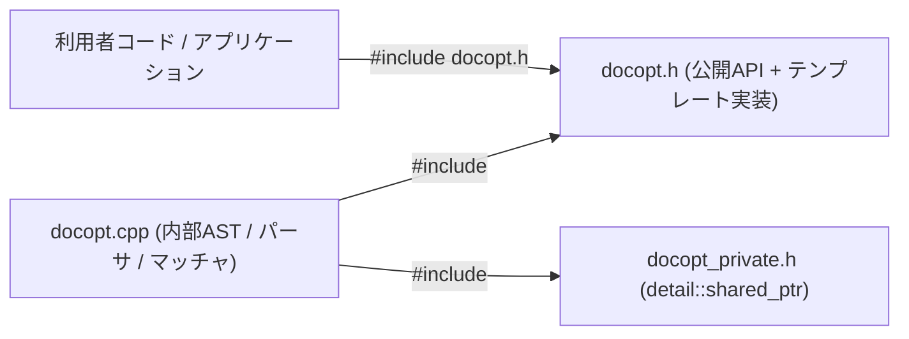
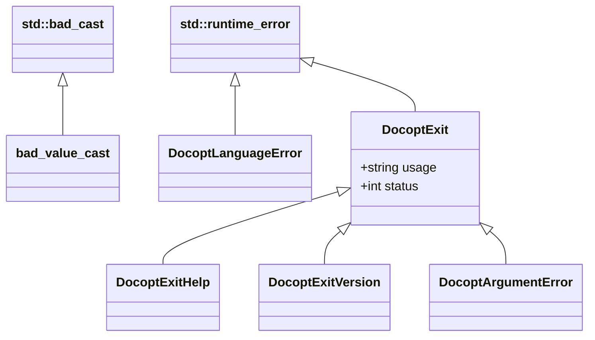
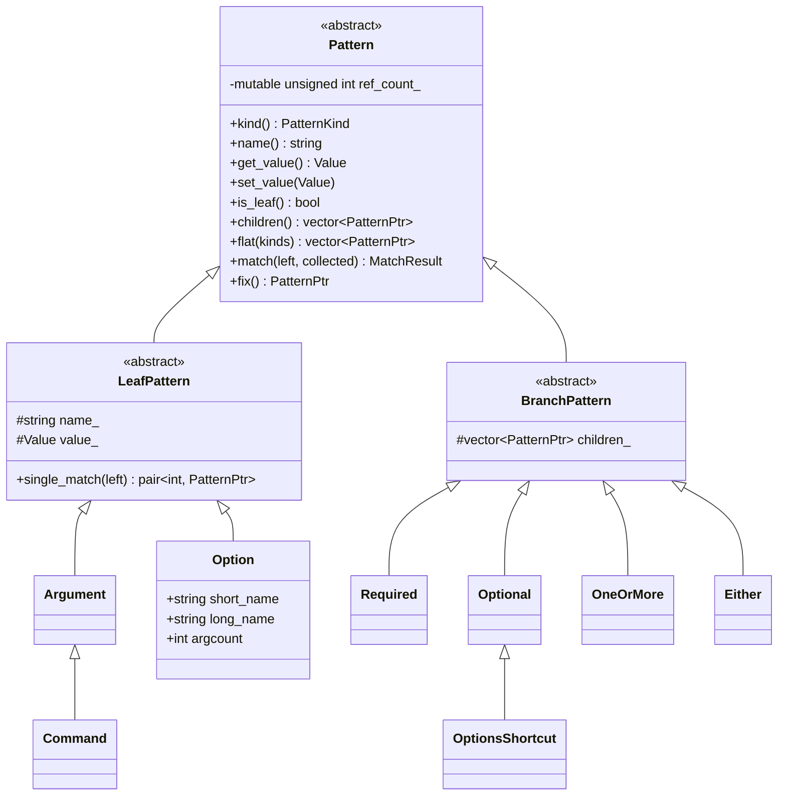
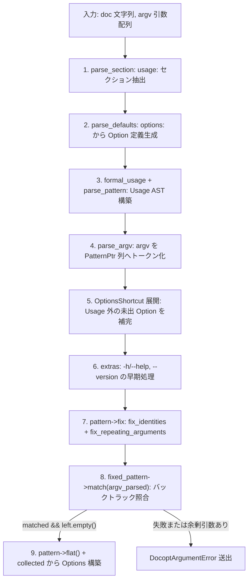

# docopt.cpp03 設計文書 (Architecture & Developer Design Guide)

**対象バージョン**: `v1.5.1` 以降  
**想定読者**: 本ライブラリのメンテナンスおよび機能拡張を行う開発者  

---

## 1. 設計目標と不変条件 (Design Goals & Invariants)

`docopt.cpp03` は、Python 版 `docopt`（v0.6.2）の仕様を **厳格な ISO C++03 環境** 向けに移植したコマンドライン引数パーサライブラリです。本ライブラリを変更・拡張する際は、以下の不変条件（Invariants）を常に維持してください。

1. **厳格な C++03 準拠とレガシーコンパイラ互換性**
   - `-std=c++03 -pedantic-errors -Wall -Wextra -Wshadow -Wsign-compare` で警告・エラーなくコンパイルできること。
   - GCC 3.4.5 等の古い C++03 コンパイラ（Pre-DR 214、古い `-Wshadow` 仕様）でもビルド可能であること（詳細は第 5 節参照）。
2. **ゼロ外部依存 (Zero-Dependency)**
   - Boost やサードパーティライブラリに一切依存せず、C++03 標準ライブラリのみで構成すること。
3. **Python `docopt` v0.6.2 互換性**
   - 公式テストスイート `docopt.python/testcases.docopt`（全 175 ケース）の 100% 合格を維持すること。
4. **クリーンなヘッダ境界（Pimpl 的カプセル化）**
   - 公開ヘッダ [docopt.h](../docopt.h) には公開 API とインラインテンプレート実装のみを配置し、AST 構築・パーサ・スマートポインタなどの内部実装は [docopt_private.h](../docopt_private.h) および [docopt.cpp](../docopt.cpp) に隠蔽すること。
5. **メモリ安全性**
   - ASan / UBSan（`-fsanitize=address,undefined`）下でリーク・Use-After-Free・範囲外アクセスが発生しないこと。

---

## 2. 全体アーキテクチャとモジュール構成

### 2.1 ファイル構成

| ファイル | 役割 | コンパイル制約 |
| :--- | :--- | :--- |
| [docopt.h](../docopt.h) | 公開 API 宣言（Part 1）およびテンプレート実装（Part 2）。外部利用者がインクルードする唯一のヘッダ | C++03 厳格準拠 / GCC 3.4.5 互換 |
| [docopt_private.h](../docopt_private.h) | ライブラリ内部専用の侵入型スマートポインタ `detail::shared_ptr<T>` の定義 | C++03 厳格準拠 / GCC 3.4.5 互換 |
| [docopt.cpp](../docopt.cpp) | `Value` / `Options` / 例外の非テンプレート実装、AST ノード群、字句・構文パーサ、マッチャ、エントリポイント | C++03 厳格準拠 / GCC 3.4.5 互換 |
| [test_docopt.cpp](../test_docopt.cpp) | `docopt.python/testcases.docopt`（175 件）を実行する簡易 JSON パーサ付きテストランナー | `-std=c++03 -pedantic-errors` |
| [unit_tests.cpp](../unit_tests.cpp) | GoogleTest v1.7.0 による単体テストスイート（89 件） | `-std=c++03 -pedantic-errors` |
| [third_party/googletest-release-1.7.0.tar.gz](../third_party/googletest-release-1.7.0.tar.gz) | オフラインビルド用の GoogleTest v1.7.0 同梱アーカイブ | CMake configure 時に展開 |
| [CMakeLists.txt](../CMakeLists.txt) | ビルド設定、`ENABLE_ASAN` オプション、サンプル（`naval_fate`, `calculator`）およびテスト定義 | CMake 3.11+ |

### 2.2 ヘッダ二部構成と依存関係

[docopt.h](../docopt.h) は可読性とヘッダ単体利用性を両立するため、以下の二部構成を採用しています。

- **PART 1 (`L27-L248`)**: 例外クラス、`Value`、`Options`、`docopt_parse` / `docopt` の宣言のみを配置し、利用者が API 全体を一目で把握できるようにしています。
- **PART 2 (`L251-L406`)**: `bad_value_cast::what()`、`detail::lexical_caster` / `detail::lexical_cast`、コンパイル時型チェック、および `Value` / `Options` のメンバ関数テンプレート実装を配置しています。



---

## 3. 公開 API とデータモデル設計

### 3.1 `Value` クラス（動的バリアント型）

[docopt.h:73-147](../docopt.h#L73-L147) / [docopt.cpp:112-325](../docopt.cpp#L112-L325)

パース結果のオプション値・引数値・コマンドフラグを統一的に表現する値型です。内部では `enum Kind` タグによって状態を管理します。

| `Value::Kind` | 保持する主なメンバ | 生成契機・用途 |
| :--- | :--- | :--- |
| `KIND_EMPTY` | なし | デフォルト未設定の値、オプション引数未指定時、存在しないキー参照時の空値 |
| `KIND_BOOL` | `bool_val_`（および `str_val_`） | フラグオプション・コマンドの有無（`true` / `false`） |
| `KIND_LONG` | `long_val_`（および `str_val_`） | 繰り返しフラグの回数カウント（`-vvv` → `3L`）、整数コンストラクタ |
| `KIND_STRING` | `str_val_`（遅延キャッシュ `str_list_val_`） | オプション引数、位置引数、デフォルト値 `[default: ...]` |
| `KIND_STRING_LIST` | `str_list_val_` | 繰り返し位置引数（`<file>...`）や繰り返し引数付きオプション |

#### 型照会 `is<T>()` とコンパイル時制約

- `is<T>()` は保持している `kind_` のみを判定します（文字列 `"42"` に対して `is<long>()` は `false`）。
- プライマリテンプレート `Value::is<T>()`（[docopt.h:308-313](../docopt.h#L308-L313)）は `detail::docopt_is_supported_type<detail::is_supported_value_type<T>::value>` を実体化し、サポート対象型（`bool`, `long`, `int`, `std::string`）以外が渡された場合に **C++03 互換の不完全型エラー（擬似 `static_assert`）** を発生させます。
- `Value::is<int>()` は `kind_ == KIND_LONG` を返します（`Value(int)` コンストラクタは内部で `KIND_LONG` として格納するため）。

#### 型変換 `as<T>()`・フォールバック `as_or<T>()`・`detail::lexical_cast`

`as<T>()` は型ごとに変換戦略を分けています。

1. **特殊化済み型**（[docopt.cpp:154-234](../docopt.cpp#L154-L234)）:
   - `as<bool>()`: `KIND_BOOL` → そのまま、`KIND_LONG` → `long_val_ != 0`、`KIND_STRING` → `trim` + `to_lower` 後に `"true"/"1"/"yes"/"on"` を `true`、`"false"/"0"/"no"/"off"/""` を `false`、それ以外は `bad_value_cast`。
   - `as<long>()`: `KIND_LONG` → そのまま、`KIND_STRING` → `detail::lexical_cast<long>(str_val_)`、`KIND_BOOL` → `1L / 0L`。
   - `as<int>()`: `KIND_LONG` → `INT_MIN`〜`INT_MAX` 範囲検査後に `static_cast<int>`（範囲外は `bad_value_cast`）、`KIND_STRING` → `detail::lexical_cast<int>(str_val_)`、`KIND_BOOL` → `1 / 0`。
   - `as<double>()`: `KIND_LONG` → `static_cast<double>`、`KIND_STRING` → `detail::lexical_cast<double>(str_val_)`、`KIND_BOOL` → `1.0 / 0.0`。
   - `as<std::string>()`: `KIND_STRING` → そのまま、`KIND_LONG` → `std::ostringstream` 整形、`KIND_BOOL` → `"true" / "false"`。
2. **プライマリテンプレート `as<T>()`**（[docopt.h:332-342](../docopt.h#L332-L342)）:
   - 上記以外の型（例：`unsigned long`, `float`, `short`）は `detail::lexical_cast<T>` に委譲します。
   - 変換失敗時（空文字列、余剰文字、オーバーフロー等）および `KIND_EMPTY` / `KIND_STRING_LIST` からの変換は `bad_value_cast`（`bad_lexical_cast` エイリアス）を送出します。
3. **`as_or<T>(default_val)`**（[docopt.h:364-376](../docopt.h#L364-L376)）:
   - `is_empty()` または `bad_value_cast` 捕捉時に `default_val` を返却します。`const char*` オーバーロードは `NULL` 入力を空文字列へ安全に変換します。
4. **`as_string_list()` と `as_list<T>()`**:
   - `as_string_list()`（[docopt.cpp:147-152](../docopt.cpp#L147-L152)）は `KIND_STRING` 時に `mutable str_list_val_` へ 1 要素を遅延キャッシュし、`const std::vector<std::string>&` 参照の寿命を安全に保証します。
   - `as_list<T>()`（[docopt.h:379-391](../docopt.h#L379-L391)）は各文字列要素を `Value(elem).as<T>()` に委譲するため、`as<bool>()` や `as<int>()` 等の変換規則がそのまま適用されます。

#### `is_truthy()` と `as<bool>()` の違い

- `operator unspecified_bool_type()` および `operator!()` は `is_truthy()`（[docopt.cpp:236-245](../docopt.cpp#L236-L245)）を呼びます。これは Python の真偽値評価に準拠しており、**空でない文字列（例：`"false"`, `"0"`）は `true`** になります。
- 一方、`as<bool>()` は文字列の内容を真偽値として解釈します。

### 3.2 `Options` クラス（結果コンテナ）

[docopt.h:155-202](../docopt.h#L155-L202) / [docopt.cpp:1634-1707](../docopt.cpp#L1634-L1707)

- `std::map<std::string, Value>` を `private` メンバ `map_` としてコンポジションしています（STL コンテナ継承による非仮想デストラクタ問題を回避）。
- **参照セマンティクス**:
  - `const Options::operator[](key)`: 存在しないキーに対して `static const Value empty_val;` への `const` 参照を返し、マップを汚染しません。
  - `Options::at(key)`: 存在しないキーに対して `std::out_of_range` を送出します。
  - `Options::get<T>(key, default_val)`: キー存在時は `it->second.as_or<T>(default_val)` を返し、未存在または変換失敗時に `default_val` を返します。

### 3.3 例外階層とエントリポイント



- `docopt_parse()`: パースエラー時に `DocoptLanguageError`（docstring 構文エラー）または `DocoptExit` 派生クラスを送出する純粋パーサ。RAII を重視するアプリケーション向け。
- `docopt()`: 内部で `docopt_parse()` を呼び、`DocoptExit` / `DocoptLanguageError` を捕捉して出力後に `std::exit()` でプロセス終了する簡易ラッパー。

---

## 4. 内部実装設計（AST・メモリ管理・パース／マッチング）

### 4.1 侵入型スマートポインタ `detail::shared_ptr<T>`

[docopt_private.h:8-47](../docopt_private.h#L8-L47)

C++03 標準には `std::shared_ptr` が存在せず、かつ AST グラフはノード共有（`fix_identities()` による同一リーフの共有と `transform()` での部分木複製）を伴うため、`Pattern` 側の `mutable unsigned int ref_count_`（`add_ref()` / `release_ref()`）と連携する侵入型スマートポインタを採用しています。

- **UAF・自己代入防止の契約**:
  `operator=` では必ず先に `new_px->add_ref()` を実行してから古い `px->release_ref()` を実行します。これにより、`p = p->child;` のような連鎖的解放による Heap Use-After-Free や自己代入 `p = p;` の安全性を保証しています。
- **`PatternPtr(this)` 呼び出しの前提条件**:
  `LeafPattern::flat()`・`BranchPattern::flat()`・`Pattern::fix()`・`Pattern::fix_repeating_arguments()` では `PatternPtr(this)` を生成します。これはオブジェクトが既に別の `PatternPtr` によって所有されている（`ref_count_ >= 1`）ことを前提としており、未所有の生ポインタに対して直接これらを呼び出してはなりません。
- **循環参照の不在**:
  AST は親から子への単方向参照（DAG）のみで構成され、親への逆参照を持たないため循環参照は発生しません。

### 4.2 `Pattern` AST クラス階層

[docopt.cpp:331-842](../docopt.cpp#L331-L842)



### 4.3 パースおよびマッチングの全体パイプライン



各ステージの設計上の重要ポイントは以下の通りです。

1. **セクション抽出 (`parse_section`) と `formal_usage`**（[docopt.cpp:1347-1447](../docopt.cpp#L1347-L1447)）:
   - 行単位で小文字化した文字列に対し `find("usage:")` / `find("options:")` でセクションを抽出します。
   - `formal_usage()` は先頭のプログラム名トークンを基準に各行を `( ... ) | ( ... )` の排他選択表現へ変換します。
2. **オプション定義解析 (`parse_defaults` / `Option::parse`)**（[docopt.cpp:590-635](../docopt.cpp#L590-L635), [L1385-1425](../docopt.cpp#L1385-L1425)）:
   - `-` で始まる行から継続行を含むオプションブロックを切り出します。
   - `"  "`（2連スペース）でオプション部と説明部を分離し、オプション部の `,` / `=` を空白置換して単語分割し、`short_name`, `long_name`, `argcount`（0 または 1）を決定します。
   - 説明部から大文字小文字不問で `[default: ...]` を抽出します（`argcount == 1` のときのみ）。
3. **Usage 文法の再帰下降パーサ**（[docopt.cpp:1002-1318](../docopt.cpp#L1002-L1318)）:
   - `Tokens::from_pattern()` が `...` と `[` `]` `(` `)` `|` を空白で分離し、`<...>` を単一トークンとして保持します。
   - 文法優先順位: `expr`（`|` で区切られた `Either`） → `seq`（連結と後置 `...` による `OneOrMore`） → `atom`（`( )` `Required`, `[ ]` `Optional`, `options` `OptionsShortcut`, `--...`, `-...`, `<arg>` / 大文字 `Argument`, 小文字 `Command`）。
   - 未閉じ括弧や末尾の未消費トークンがあれば `DocoptLanguageError` を送出します。
4. **`argv` トークン化 (`parse_argv`)**（[docopt.cpp:1320-1345](../docopt.cpp#L1320-L1345)）:
   - `--`: 以降の全引数を位置引数 `Argument("", val)` として取り込みます。
   - `-` 単体: 位置引数（またはUsage上の `-` コマンド一致候補）として `Argument("", "-")` を生成します。
   - `--name` / `--name=val`: `parse_long()` で完全一致→前方一致（`ERROR_EXIT` 時のみ）を検索し、複数一致なら曖昧性エラー、引数不足／過剰ならエラーを送出します。
   - `-abc` / `-oval`: `parse_shorts()` で 1 文字ずつ分解し、引数付きオプション（`argcount != 0`）が出たら残りの文字列または次トークンを値として消費します。
   - `options_first == true`: 最初の位置引数を検出した時点で残りの全トークンを位置引数として確定します。
5. **AST 正規化 (`Pattern::fix()`)**（[docopt.cpp:848-980](../docopt.cpp#L848-L980)）:
   - `fix_identities()`: AST 全体の全リーフから `repr()` が一致するものを同一 `PatternPtr` インスタンスに統一します。
   - `fix_repeating_arguments()`: `transform()` によってネストした `BranchPattern` を選言標準形（`Either` の子に `Required` が並ぶ平坦な展開形）に変換します。各 `Required` パス内で同一 `repr()` のリーフが 2 回以上出現（`OneOrMore` 展開による重複含む）する場合、引数／引数付きオプションなら初期値を `KIND_STRING_LIST`（デフォルト値があれば `split_words` で分割）、コマンド／フラグなら `KIND_LONG (0L)` に昇格させます。
   - `fix_identities()` によりリーフインスタンスが共有されているため、`transformed` 側のリーフへの `set_value()` がそのまま元の `pattern` ツリーへ反映されます。
6. **マッチングとバックトラック (`Pattern::match`)**（[docopt.cpp:421-842](../docopt.cpp#L421-L842)）:
   - `MatchResult` は `(matched, (left, collected))` を値渡しで返却します。`Required` / `Either` が失敗した場合は元の `(left, collected)` を返してバックトラックします。
   - `Either` は成功した全分岐の中から **未消費引数 `left.size()` が最小** の結果を選択します。
   - `OneOrMore` は `l_prev == l` 検出により引数を消費しない空マッチ（例：`[<a>]...`）での無限ループを防止しています。
   - `LeafPattern::match()` は `value_` が `KIND_LONG` または `KIND_STRING_LIST` の場合、`collected` 内の同名要素を検索して回数加算またはリスト連結を行います。

---

## 5. C++03 & レガシーコンパイラ（GCC 3.4.5+）移植性制約

本ライブラリでは、`AGENTS.md` にも記載されている以下の設計パターンを厳守しています。

1. **クラステンプレート部分特殊化による関数テンプレート曖昧性回避（Pre-DR 214 対策）**
   - [docopt.h:265-292](../docopt.h#L265-L292): `detail::lexical_cast<Target>(arg)` は、関数テンプレートをオーバーロードせず単一の関数テンプレートとし、クラステンプレート `detail::lexical_caster<Target, Source>` およびその部分特殊化 `detail::lexical_caster<Target, std::string>` へ処理を委譲しています。
   - 理由：戻り値型にのみ現れる明示テンプレート引数 `Target` を持つ関数テンプレートをオーバーロードすると、GCC 3.4.5（CWG DR 214 適用前）の関数テンプレート部分順序付けで両候補が推論失敗となり曖昧性エラーになるためです。
2. **非静的メンバ関数における `-Wshadow` 衝突回避**
   - [docopt.cpp:402-801](../docopt.cpp#L402-L801): GCC 3.4.5 の `-Wshadow` はコンストラクタ・非静的メンバ関数内の仮引数／ローカル変数が、基底クラスを含むメンバ関数（`Pattern::name()`, `Pattern::children()` 等）と同名でも警告を出します。
   - そのため、メンバ関数名・メンバ変数名と衝突しない引数名（`pattern_name`, `child_patterns`, `usage_str`, `exit_status` 等）を徹底しています（`static` メンバ関数には `this` が存在しないため対象外）。
3. **C++03 構文制約**
   - 入れ子テンプレートの右山括弧は必ず `> >` とスペースを空けます。
   - コンパイル時アサーションには `detail::docopt_is_supported_type<cond>` のような不完全型トリックを使用します。
   - C 標準ヘッダは `<cctype>`, `<cstdlib>`, `<cassert>`, `<climits>` の `<c*>` 形式を使用し、`std::` 修飾またはマクロを適切に扱います。

---

## 6. 機能拡張ガイド（開発者向けレシピ）

### レシピ 1: `Value` に新しい型サポートを追加する

例として新しい型 `NewType` の `is<NewType>()` や `as<NewType>()` を追加する場合：

1. **`is<NewType>()` が必要な場合**:
   - 必要に応じて `Value::Kind` に新しい列挙子と保持メンバを追加（[docopt.h:75-146](../docopt.h#L75-L146)）。
   - `detail::is_supported_value_type<NewType>` の特殊化を [docopt.h:297-303](../docopt.h#L297-L303) に追加。
   - `Value::is<NewType>()` の明示的特殊化宣言を [docopt.h:315-326](../docopt.h#L315-L326) に追加し、定義を [docopt.cpp](../docopt.cpp) に実装。
   - `Value::operator==`, `operator<`, `is_truthy()`, `to_json()` の `switch (kind_)` を全網羅で更新。
2. **`as<NewType>()` のみ特化したい場合**（`Value::Kind` は増やさず変換ロジックをカスタマイズ）:
   - [docopt.h:344-358](../docopt.h#L344-L358) に `template <> NewType Value::as<NewType>() const;` を宣言し、[docopt.cpp](../docopt.cpp) に定義を追加。
   - （文字列からの汎用ストリーム変換で十分な型であれば、特殊化なしでプライマリ `Value::as<T>()` + `detail::lexical_caster` が自動的に動作します。）
3. **テスト**:
   - `unit_tests.cpp` に `is<NewType>()`, `as<NewType>()`, `as_or<NewType>()`, `as_list<NewType>()` の正常系・`bad_value_cast` 異常系を追加。

### レシピ 2: 新しい AST パターンノードや Usage 構文を追加する

1. [docopt.cpp](../docopt.cpp) の `enum PatternKind`（`L331`）に種別を追加。
2. リーフ系なら `LeafPattern`、ブランチ系なら `BranchPattern` を継承したクラスを実装。
   - **注意**: コンストラクタの仮引数名・非静的メンバ関数内のローカル変数名が `Pattern::name()`, `Pattern::children()`, `kind()`, `repr()`, `flat()`, `match()` 等と衝突しないように命名する（GCC 3.4.5 `-Wshadow` 対策）。
3. `Tokens::from_pattern()`（`L1002`）および構文解析関数（`parse_atom`, `parse_seq`, `parse_expr`）にトークン切り出し・AST 生成ロジックを追加。
4. `transform()`（`L927`）が新しいブランチ種別を正しく展開できるか確認（特殊な展開規則が必要なら `child->kind() == KIND_...` 分岐を追加）。
5. `docopt.python/testcases.docopt` の 175 テストが壊れていないこと、および新構文のテストを `unit_tests.cpp` に追加して確認。

### レシピ 3: `docopt_parse` / `docopt` に新しい動作オプションを追加する

1. [docopt.h:211-244](../docopt.h#L211-L244) の 4 つのオーバーロード（`docopt_parse` ×2、`docopt` ×2）すべてに一貫して引数（後方互換のためデフォルト引数付き）を追加し、[docopt.cpp:1494-1628](../docopt.cpp#L1494-L1628) の定義も同期する。
2. `argc, argv` オーバーロードから `std::vector<std::string>` オーバーロードへ新しい引数を必ず転送する。
3. [README.md](../README.md) のシグネチャとパラメータ説明を更新する。

### レシピ 4: `Options` API を拡張する際のチェックリスト

1. 新規テンプレートメンバ関数を追加する場合、宣言は [docopt.h](../docopt.h) の Part 1（`Options` クラス内）、実装は Part 2（`L393` 以降）に配置する。
2. 関数テンプレートのオーバーロードを追加する場合、戻り値型のみに現れる明示テンプレート引数で部分順序付けが発生しないか確認する（GCC 3.4.5 対策）。
3. `const` 版と非 `const` 版の一貫性（特に存在しないキー参照時に `map_` へ挿入しない保証）を確認する。

---

## 7. 既知の設計トレードオフ・制約事項とテスト戦略

### 7.1 既知の設計トレードオフ・制約

| 項目 | 箇所 | 内容と背景 |
| :--- | :--- | :--- |
| **`parse_section()` の行内部分一致** | [docopt.cpp:1357-1365](../docopt.cpp#L1357-L1365) | C++03 に `<regex>` がないため `lower_line.find(lower_name)` で判定。本文途中に `"usage:"` / `"options:"` を書くとセクション開始と誤認する制約がある |
| **`Pattern::children()` の非 `const` 静的空ベクタ** | [docopt.cpp:369-372](../docopt.cpp#L369-L372) | リーフのデフォルト実装が `static empty_children` の非 `const` 参照を返す。全呼び出しサイトは `is_leaf()` ガードまたは `BranchPattern` 限定だが、拡張時にリーフの `children()` へ書き込まないこと |
| **符号なし型への負数変換** | [docopt.h:266-285](../docopt.h#L266-L285) | 特殊化されていない `Value::as<unsigned long>()` 等に `"-1"` を渡すと、`std::stringstream`（`std::num_get`）仕様上エラーにならずラップアラウンドする |
| **`Value::as<T>()` への CV 修飾型** | [docopt.h:332-342](../docopt.h#L332-L342) | `as<const int>()` 等は明示的特殊化に一致せずプライマリテンプレートへ進むため非サポート |

### 7.2 検証・テストコマンド

変更時は、通常（Release）ビルドと AddressSanitizer + UBSan ビルドの双方で全テスト合格を確認します。

```bash
# 厳格 C++03 単体コンパイルチェック
clang++ -std=c++03 -pedantic-errors -Wall -Wextra -Wshadow -Wsign-compare -O2 -I. -c docopt.cpp -o /dev/null

# AddressSanitizer + UBSan ビルド & テスト
mkdir -p build_asan && (cd build_asan && cmake -DENABLE_ASAN=ON .. && cmake --build . && ctest --output-on-failure)

# Release ビルド & テスト
mkdir -p build_release && (cd build_release && cmake -DCMAKE_BUILD_TYPE=Release .. && cmake --build . && ctest --output-on-failure)
```
